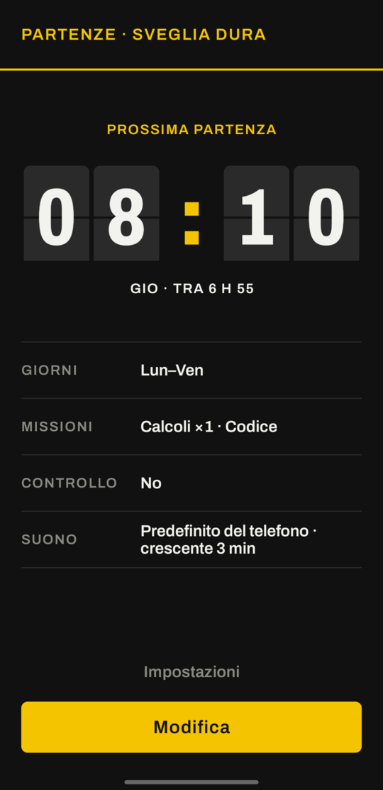
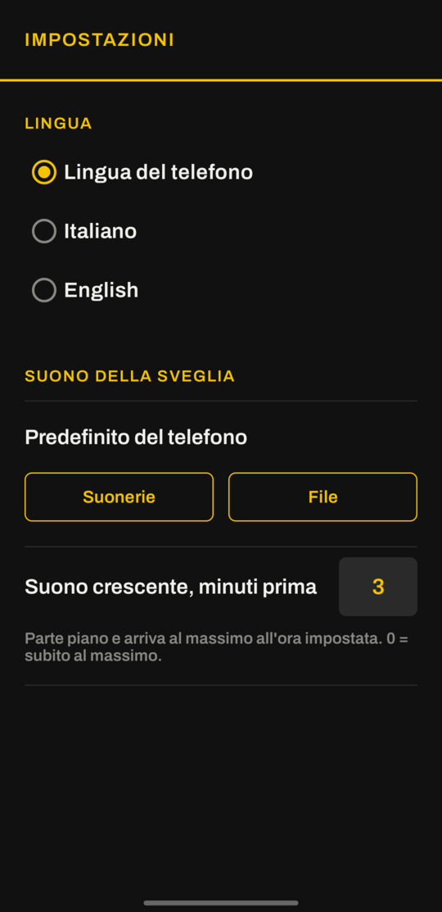

# Sveglia Dura

Una sveglia Android che non si spegne con un dito. Per farla smettere devi alzarti e completare delle missioni: risolvere calcoli, scuotere il telefono o scansionare un codice a barre che hai lasciato lontano dal letto.

[English](README.md)

<p align="center">
  
  
  
</p>
<p align="center">
  
  
  
</p>

## Perché

Una sveglia normale perde contro un pollice mezzo addormentato. Sveglia Dura è fatta per renderlo più difficile:

| Funzione | Come funziona |
|---|---|
| **Missione calcoli** | N operazioni tipo `7 × 8 + 6`. Se sbagli ne arriva un'altra. |
| **Missione scuoti** | Scuoti forte il telefono N volte (accelerometro). |
| **Missione codice a barre / QR** | Registri un codice lontano dal letto (dentifricio, caffè, QR attaccato in bagno). Per spegnere la sveglia devi andare lì a scansionarlo. È la missione che funziona meglio. |
| **Suono crescente** | Parte qualche minuto prima (3 di default, da 0 a 5) quasi in silenzio e arriva al massimo esattamente all'ora impostata. La vibrazione parte all'ora impostata. |
| **Il tuo suono** | Una qualsiasi suoneria del telefono oppure un file audio. Se il file sparisce, usa il suono di sveglia del telefono. |
| **Volume bloccato** | Il volume della sveglia viene riportato al massimo ogni secondo, anche se lo abbassi. |
| **Niente snooze, niente tasto indietro** | Il tasto indietro non chiude la schermata. Se esci con Home, la sveglia continua a suonare. |
| **Controllo anti-ricaduta** | Qualche minuto dopo averla spenta ti chiede "Sei sveglio?". Se non rispondi entro 60 secondi, ricomincia a suonare con tutte le missioni. |
| **Resiste a riavvii e crash** | Se spegni il telefono o il sistema chiude l'app, la sveglia e il controllo "Sei sveglio?" ripartono appena possono. |
| **Sopra la schermata di blocco** | Accende lo schermo e compare a schermo intero. |
| **Uscita d'emergenza** | Se non trovi il codice, puoi sostituirlo con 8 calcoli: scomodi, ma non resti bloccato. |
| **Italiano e inglese** | Segue la lingua del telefono, oppure la scegli nelle Impostazioni. |

## Grafica

L'interfaccia ricorda il tabellone Solari delle partenze in stazione, e la sveglia è il treno da prendere. La schermata iniziale mostra la prossima partenza sulle tessere, con sotto giorni, missioni, controllo e suono. L'ora si imposta su un rullo di tessere a palette, le missioni sono elencate come binari e nella schermata della sveglia ogni cifra sta su una tessera che si ribalta quando cambia. Quando suona c'è un solo compito per volta, scritto in grande, e tutta l'app è scura così non illumina la stanza quando la imposti la sera.

Font: [Archivo](https://github.com/Omnibus-Type/Archivo) (SIL Open Font License 1.1), incluso in `app/src/main/res/font/`.

## Installazione

Scarica `sveglia-dura-vX.Y.Z.apk` dall'[ultima release](https://github.com/Macchp3840/sveglia/releases/latest) e aprilo sul telefono. La prima volta Android ti chiede di consentire le installazioni da quella fonte (il browser o il file manager). Le release successive sono firmate con la stessa chiave, quindi si installano sopra la versione vecchia e le impostazioni restano.

Per compilarla da solo servono JDK 17 e l'SDK Android:

```bash
./gradlew assembleDebug
# APK in app/build/outputs/apk/debug/
```

Ogni push lancia anche il workflow `Build APK`, che salva un APK di debug come artifact di GitHub Actions. Un tag come `v1.2.0` lancia `Release APK`, che compila l'APK firmato e lo allega a una release.

Requisiti: Android 8.0 o successivo. Per la scansione dei codici servono i Google Play Services.

## Primo avvio

1. Concedi le notifiche (senza di quelle la sveglia non può comparire sullo schermo).
2. Se compare un avviso rosso, premi **Risolvi** e concedi il permesso indicato.
3. Premi **Modifica**, gira il rullo sull'ora che vuoi, scegli giorni e missioni, accendi l'interruttore e premi **Salva**.
4. In **Impostazioni** puoi cambiare lingua, suono della sveglia e minuti di suono crescente.
5. Usa **Prova: suona tra 10 secondi** e blocca il telefono per vedere come funziona davvero (la prova suona subito al massimo).

## Limiti noti

- Spegnere il telefono, fare *forza arresto* o disinstallare l'app ferma la sveglia. Nessuna app normale può impedirlo (il riavvio però la fa ripartire, vedi sopra).
- La missione "scuoti" si può fare anche dal letto. Per alzarti davvero usa il codice a barre.
- Con il telefono bloccato, la scansione del codice chiede di sbloccare lo schermo.
- Se il controllo "Sei sveglio?" parte mentre usi il telefono, Android lo mostra come notifica e non a schermo intero; se lo ignori, dopo 60 secondi la sveglia suona comunque.
- Alcune marche (Xiaomi, Huawei, Oppo...) uccidono le app in background in modo aggressivo: conviene togliere l'ottimizzazione batteria per questa app.
- Con il suono crescente, la "prossima sveglia" che Android mostra nella barra di stato e sulla schermata di blocco è l'inizio della salita, qualche minuto prima dell'ora impostata.

## Idee per le prossime versioni

- Foto di un luogo: fotografi il lavandino una volta e la sveglia si spegne solo quando una nuova foto corrisponde.
- Camminare N passi, contati dal sensore contapassi.
- Ripetere una sequenza di colori, oppure riscrivere una frase lunga senza errori.
- Più sveglie con missioni diverse, per esempio una più leggera nel weekend.
- Blocco serale: dopo una certa ora non puoi più spostare o spegnere la sveglia di domani.
- Statistiche e serie di giorni in cui ti sei alzato subito.

## Tecnica

Kotlin, Android Views, Material Components. `AlarmManager.setAlarmClock` per gli allarmi esatti, un servizio in primo piano `mediaPlayback` per suono e vibrazione e lo scanner di codici ML Kit, che passa dai Google Play Services e quindi non chiede il permesso della fotocamera. Testi in italiano e inglese, con la scelta della lingua per app di AppCompat.

## Licenza

[MIT](LICENSE)

Fatta da [Macchp3840](https://github.com/Macchp3840).
