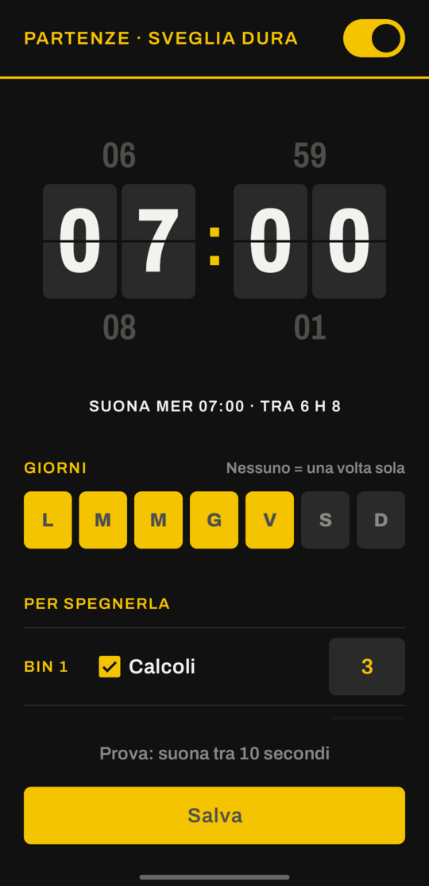
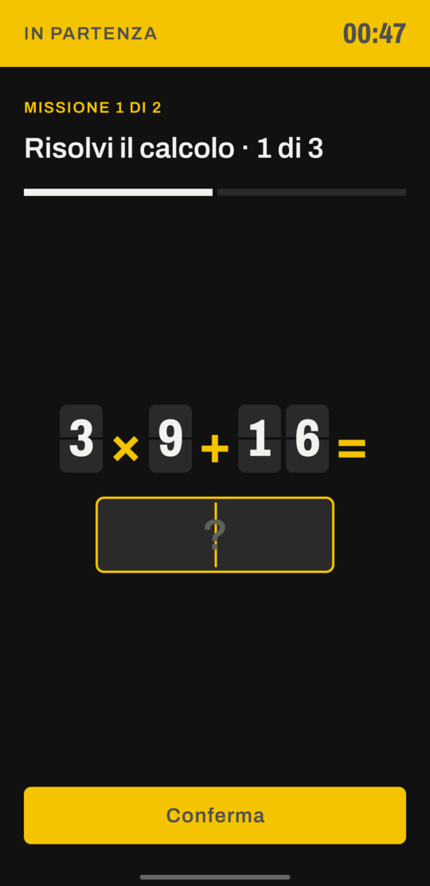
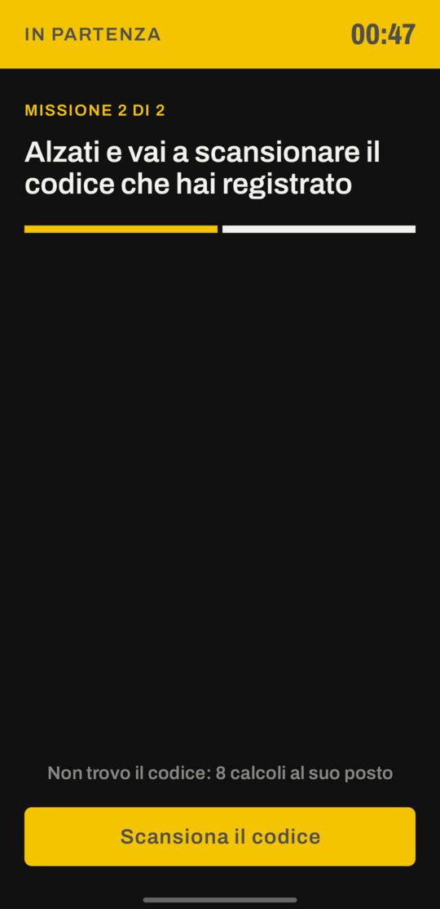
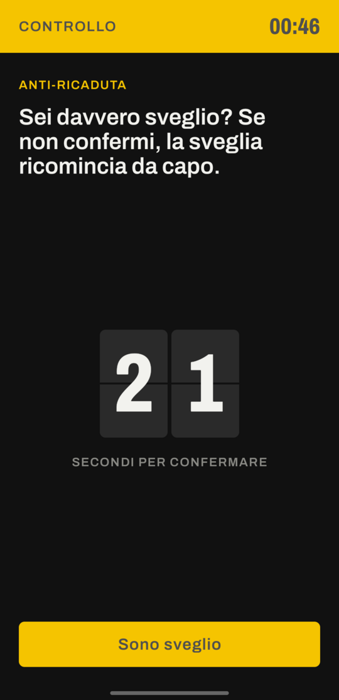

# Sveglia Dura

An Android alarm clock you can't switch off with one finger. To silence it you have to get up and complete missions: solve math problems, shake the phone, or scan a barcode you've left far from your bed.

[Italiano](README.it.md)

<p align="center">
  
  
  
  
</p>

## Why

A normal alarm loses to a half-asleep thumb. Sveglia Dura (Italian for "tough alarm") is built to make that harder:

| Feature | How it works |
|---|---|
| **Math mission** | N problems like `7 × 8 + 6`. Get one wrong and you get a new one. |
| **Shake mission** | Shake the phone hard N times (accelerometer). |
| **Barcode / QR mission** | Register a code far from your bed (toothpaste, coffee, a QR taped in the bathroom). To stop the alarm you have to walk there and scan it. This is the mission that works best. |
| **Locked volume** | The alarm volume is pushed back to maximum every second, even if you turn it down. |
| **No snooze, no Back** | Back doesn't close the screen. Leaving with Home keeps it ringing. |
| **Anti-relapse check** | A few minutes after you stop it, it asks "Are you awake?". No answer within 60 seconds and it rings again, missions included. |
| **Survives reboots and crashes** | If you turn the phone off or the system kills the app, the alarm and the "Are you awake?" check come back as soon as they can. |
| **Over the lock screen** | Turns the screen on and shows up full screen. |
| **Emergency exit** | Can't find the code? Replace it with 8 math problems: annoying, but you're never stuck. |

## Design

The interface looks like a Solari split-flap departure board at a railway station, and your alarm is the train you have to catch. You set the time on a scroll wheel of flap tiles, the missions are listed like platforms, and on the alarm screen every digit sits on a tile that flips when it changes. The alarm screen shows one task at a time in large type, and the whole app is dark so it doesn't light up the room when you set it at night.

Font: [Archivo](https://github.com/Omnibus-Type/Archivo) (SIL Open Font License 1.1), bundled in `app/src/main/res/font/`.

## Install

Download `sveglia-dura-vX.Y.Z.apk` from the [latest release](https://github.com/Macchp3840/sveglia/releases/latest) and open it on your phone. Android will ask you to allow installs from that source (your browser or file manager) the first time. Later releases are signed with the same key, so they install over the old version and keep your settings.

To build it yourself you need JDK 17 and the Android SDK:

```bash
./gradlew assembleDebug
# APK in app/build/outputs/apk/debug/
```

Every push also runs the `Build APK` workflow, which keeps a debug APK as a GitHub Actions artifact. A tag like `v1.2.0` runs `Release APK`, which builds the signed APK and attaches it to a release.

Requirements: Android 8.0 or newer. Barcode scanning needs Google Play Services.

## First run

The interface is in Italian; English translations are in brackets.

1. Allow notifications (without them the alarm can't appear on screen).
2. If a red warning shows up at the top, tap **Risolvi** (Fix) and grant the permission it asks for.
3. Roll the wheel to the time you want, pick the days and missions, turn the switch on and tap **Salva** (Save).
4. Use **Prova: suona tra 10 secondi** (test: rings in 10 seconds) and lock the phone to see how it really behaves.

## Known limits

- Powering off, *force stop* or uninstalling stops the alarm. No regular app can prevent that (a reboot does bring it back, see above).
- The shake mission can be done from bed. To actually get up, use the barcode.
- With the phone locked, scanning asks you to unlock the screen.
- If the "Are you awake?" check starts while you're using the phone, Android shows it as a notification instead of a full screen; if you ignore it, it rings again after 60 seconds anyway.
- Some brands (Xiaomi, Huawei, Oppo...) aggressively kill background apps: disable battery optimisation for this app.

## Ideas for next versions

- Photo of a place: you photograph the sink once, and the alarm only stops when a new photo matches it.
- Walk N steps, counted by the step sensor.
- Repeat a colour sequence, or retype a long sentence without mistakes.
- Several alarms with different missions, for example a lighter one at the weekend.
- Evening lock: after a set hour you can't move or turn off tomorrow's alarm any more.
- Statistics, and a streak of days you got up straight away.

## Tech

Kotlin, Android Views, Material Components. `AlarmManager.setAlarmClock` for exact alarms, a `mediaPlayback` foreground service for sound and vibration, and the ML Kit code scanner, which runs through Google Play Services so the app doesn't need the camera permission. The interface text is in Italian.

## License

[MIT](LICENSE)
